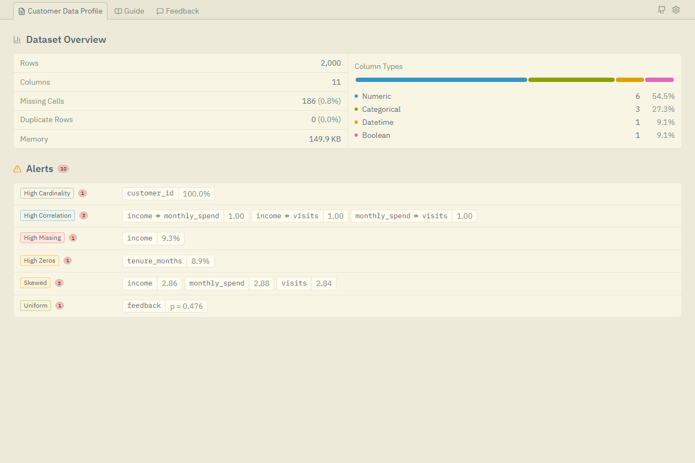
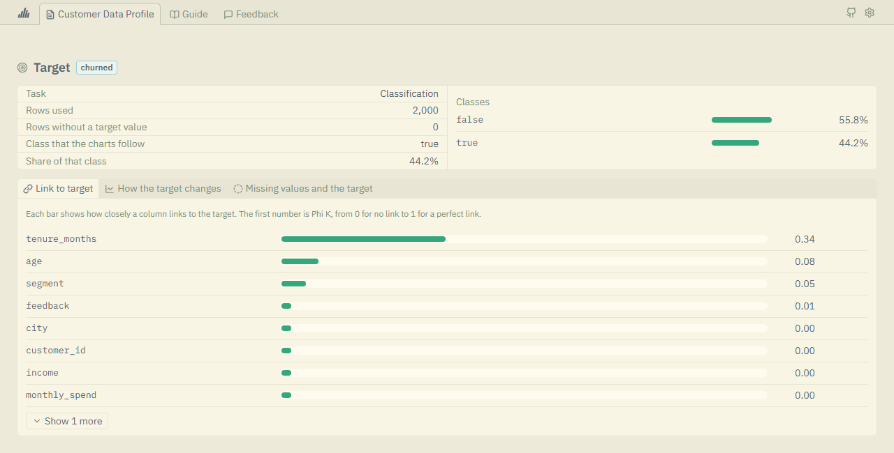
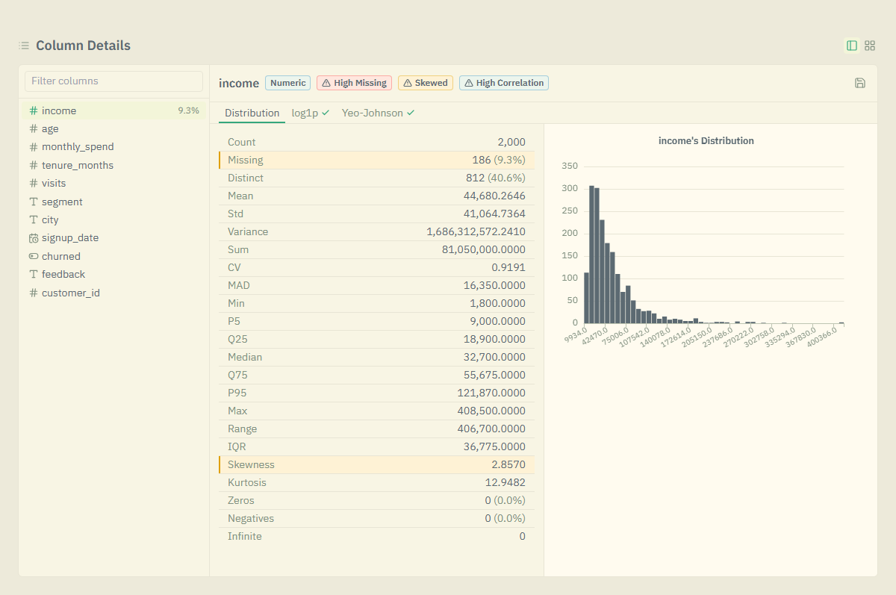
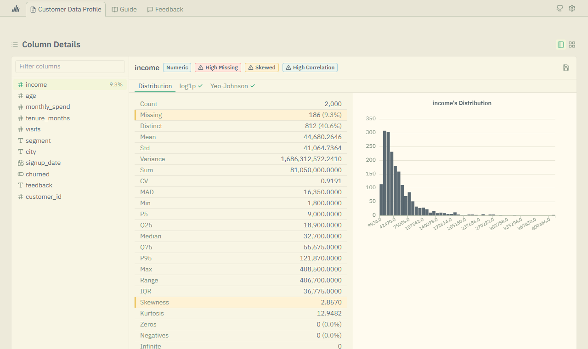
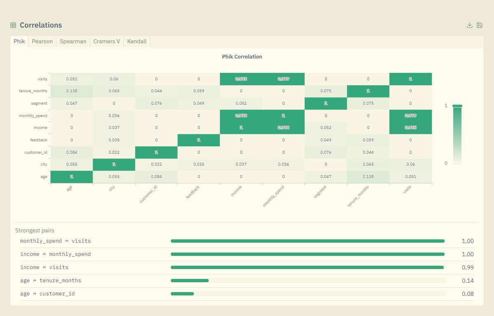
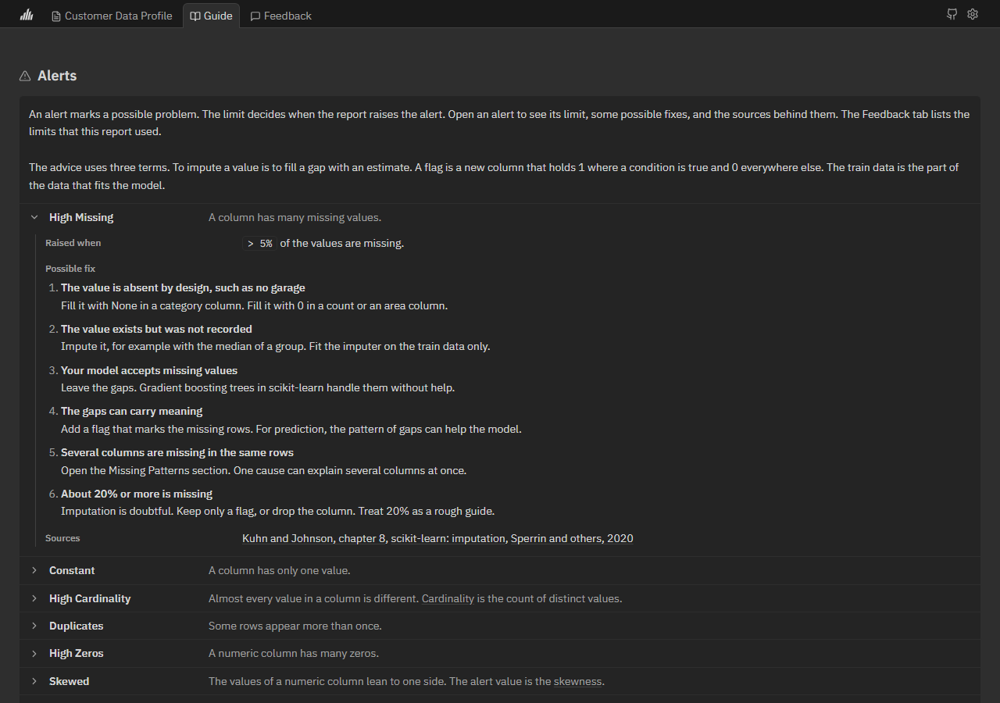

<p align="center">
  <picture>
    <source media="(prefers-color-scheme: dark)" srcset="assets/logo/wordmark-on-dark.svg">
    
  </picture>
</p>

# shirabe-profiling

[](LICENSE)


Fast data profiling for Polars. One call builds a single HTML report with charts, data quality alerts, and a guide to fix each alert.

The name comes from the Japanese word 調べ (shirabe), which means an investigation or a close look.

## Quickstart

```python
import polars as pl
from shirabe_profiling import ProfileReport

df = pl.read_csv("data.csv")
report = ProfileReport(df)
report.to_html("report.html")
```

Pandas frames, CSV paths, and Parquet paths work too.

Name the column that you want to predict to add a target section:

```python
report = ProfileReport(df, target="churned")
```

## Highlights

- **Fast.** The engine is Polars. A complete report for the Kaggle House Prices training file (1,460 rows and 81 columns) took 8 to 11 seconds. Overview mode took about 1 second. These are single runs on one machine.
- **A guide for every alert.** The Guide tab covers all 10 alerts. Each one shows when the report raises it, some possible fixes, and the sources behind them.
- **Made for modeling.** The target section shows how each column links to the target and warns about leakage. A skewed column gets tabs that show it after `log1p` and Yeo-Johnson.
- **One file.** The report is one HTML file with a dark theme and a light theme. You need an internet connection to open it, because it loads ECharts and Tailwind CSS from a CDN.
- **Easy to use in code.** Read the numbers with `.to_dict()`, `.to_json()`, `.stats`, and `.alerts`. The package is fully typed.

## What the report shows

**Overview.** Row and column counts, missing cells, duplicate rows, memory, the column types, and the alerts.

<p align="center">
  
</p>

**Target.** How each column links to the target, how the target changes across a column, and how missing values relate to the target.

<p align="center">
  
</p>

**Column details.** Statistics for each column, a tag for each alert, and a mark on the statistic that raised it. A skewed column also gets tabs for `log1p` and Yeo-Johnson, each with its own statistics.

<p align="center">
  
</p>

**Light theme.** The theme follows your system. You can also pick dark or light in the settings menu.

<p align="center">
  
</p>

**Correlations.** A heatmap for each method (Phik, Pearson, Spearman, Cramér's V, and Kendall) and a list of the strongest pairs.

<p align="center">
  
</p>

**Guide.** An alert marks a possible problem. Open an alert in the Guide tab to see its limit, some possible fixes, and the sources.

<p align="center">
  
</p>

The report also has:

- An Interactions section with scatter plots, box plots, and a column picker.
- A Missing Patterns table and an Outliers table.
- A Sample section with the first rows, the last rows, random rows, and the rows with the most gaps.

## Installation

The package is not on PyPI yet. Install it from GitHub:

```bash
pip install git+https://github.com/shuretokki/shirabe-profiling.git
```

## Usage

### Read the results in code

```python
report = ProfileReport(df, title="Customer Data Profile")

stats = report.to_dict()
alerts = report.alerts
column_stats = report.stats["age"]
correlations = report.correlations
```

### Settings

```python
from shirabe_profiling import ProfileReport, ProfileConfig

config = ProfileConfig(
    title="Customer Data Profile",
    mode="overview",
    missing_threshold=0.1,
    histogram_bins=30,
)
report = ProfileReport(df, config=config)
```

### Modes

Use `"overview"` when you want a fast first look. It skips the slow parts of the report.

| Feature | `"complete"` | `"overview"` |
|---|:-:|:-:|
| Basic stats | ✓ | ✓ |
| Histograms and value counts | ✓ | ✓ |
| Correlations | ✓ | ✗ |
| Interactions | ✓ | ✗ |
| Skew transform tabs | ✓ | ✗ |
| Missing patterns and outliers tables | ✓ | ✗ |
| Random and most missing samples | ✓ | ✗ |
| Character analysis | ✓ | ✗ |
| Duplicate rows table | ✓ | ✗ |

### Output formats

| Format | Method | Use |
|---|---|---|
| HTML | `report.to_html("report.html")` | The interactive report |
| JSON | `report.to_json("report.json")` | Other programs |
| Dict | `report.to_dict()` | Python code |

## Project

- [Contributing](CONTRIBUTING.md)
- [Changelog](CHANGELOG.md)
- [GitHub Issues](https://github.com/shuretokki/shirabe-profiling/issues)

## License

[Apache-2.0](LICENSE). The work of others that this project includes or loads is listed in [LICENSES.md](LICENSES.md).

This project began as a copy of [dataxid-profiling](https://github.com/dataxid/dataxid-profiling) by DataXID, which is also Apache-2.0.
